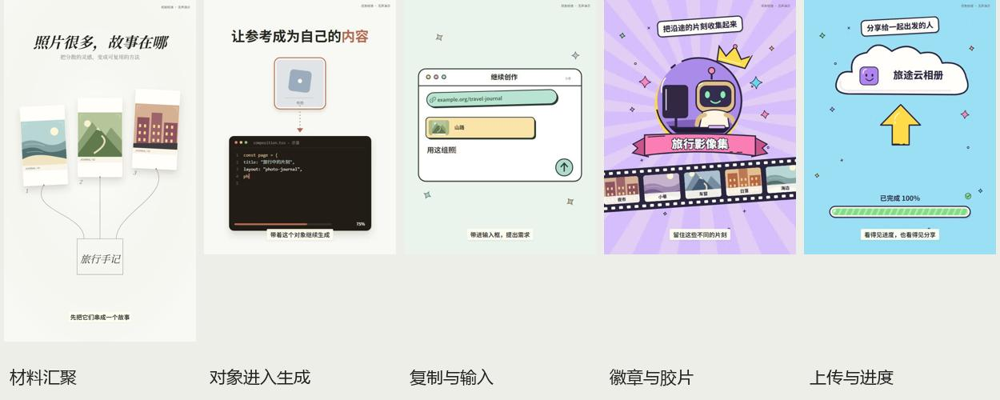

# portrait-editorial-explainer

把已有口播剪成连续的 UI 操作、物体变化和漫画说明。模型负责理解这期讲什么、用什么动作表达；可编辑的 Remotion 组件负责精细动画。

**v3 候选版：以具体参考动作重新整理。** 六组效果可换素材、标题、数量和时点，按本期意义组合；先输出本期开头 10–15 秒，用户确认风格后才继续全片。技术检查不等于人眼觉得像，当前六组仍等待用户风格评价。

[下载v3候选安装包](https://github.com/3105059695-rgb/portrait-editorial-explainer/releases/download/v3.0.0-rc.1/portrait-editorial-explainer-v3.0.0-rc.1.zip) · [Skill 入口](SKILL.md) · [动作索引与边界](references/source-style-effects.md) · [数据契约](references/source-style-contract.md) · [制作流程](references/source-style-workflow.md) · [验证记录](docs/SOURCE-STYLE-V3.md)

## 先看实际输出

下面是原创中性内容的**无声机制预览**。没有冒充用户本期的声音、人物，也不附带参考作者的原片。正常制作会保留输入的人声并匹配字幕。

| 预览 | 目的 |
|---|---|
| [15秒竖屏开头](docs/source-style/travel-opening.mp4) | 三份材料汇聚→选中参考→生成→换成本期内容 |
| [12秒漫画机制](docs/source-style/comic-calibration.mp4) | 徽章、持续胶片、圆窗接管、素材飞入云与同步进度 |
| [12秒白底操作](docs/source-style/selection-calibration.mp4) | 同一对象从搜索到生成，再逐个替换 |
| [12秒网页接力](docs/source-style/web-calibration.mp4) | 示意网页→详情→复制链接→输入→结果 |
| [15秒轻量模型试用](docs/source-style/model-trial-reading.mp4) | “读书摘录”新题的三段编排；[真实试用记录](examples/source-style/MODEL-TRIAL.md) |



源片是544×720。模板支持该比例与1080×1920重排；人物、截图、图形不拉伸。字体、景深、原片内部动态素材、声音和全部三维场景未完整恢复；详细覆盖范围见动作索引。

## 安装后直接调用

下载或克隆整个仓库，不要只拿SKILL.md。安装需要Python3.10+，渲染还需Node/npm、Remotion兼容浏览器、FFmpeg/ffprobe；依赖已锁版本。ChatCut只在未粗剪的真人口播分支需要，工具和账号由使用者环境提供。

```powershell
git clone https://github.com/3105059695-rgb/portrait-editorial-explainer.git
cd portrait-editorial-explainer
python -X utf8 scripts/install_skill.py --dry-run
python -X utf8 scripts/install_skill.py
python -X utf8 scripts/doctor.py --profile production
```

安装器默认写入 `$CODEX_HOME/skills`，未设置时写 `~/.codex/skills`；其他宿主使用 `--skills-dir <你的技能目录>`。它不覆盖非空同名目录。升级前先备份旧文件夹，或安装到新的技能父目录。无需作者电脑上的盘符、私人声音或账号。

重新打开Agent会话，输入：

```text
请使用 $portrait-editorial-explainer。
本期素材：<已有口播视频或最终配音的位置>。
素材类型：<真人原片 / 已粗剪 / 数字人 / 最终配音>。
按这套参考风格，根据本期话意复用动作，表达不了时设计新镜头。
先制作实际开头10–15秒，我看过风格后再继续全片。
保留原人声，真人原片先用ChatCut粗剪，数字人跳过。
```

宿主不自动加载时，改成“请先读取 `<实际安装位置>/SKILL.md` 并执行”。只有文稿还没有声音时，可以先讨论分镜，但不能宣称已经完成最终音画同步，也不会自动生成配音或数字人。

## 无账号跑一个可编辑样段

在Skill根目录：

```powershell
python -X utf8 scripts/new_project.py --out ../my-opening
cd ../my-opening
npm ci
npm run check
npm run render
```

输出 `out/opening.mp4`，初始内容是明确标记的无声演示。`npm run dev`打开可编辑预览；`npm run still -- 2.4 7.8`导出静帧。首次渲染可能下载浏览器，也可设置运行时环境变量 `REMOTION_BROWSER_EXECUTABLE`，不把本机路径写进Skill。

换用另一个分镜，在Skill根目录：

```powershell
python -X utf8 scripts/source_episode.py validate examples/source-style/comic-calibration.json --media-dir examples/source-style/media
python -X utf8 scripts/source_episode.py build examples/source-style/comic-calibration.json --media-dir examples/source-style/media --out ../comic-opening
```

然后进入新工程执行同样的npm命令。没有外部媒体的分镜可省略media-dir。每次out使用新或空目录，已有工程不会被覆盖。

## 正式做本期

1. 确定素材类型并完成真实前序操作。原始真人先ChatCut粗剪并保存剪切映射；已粗剪沿用；数字人跳过粗剪；配音直接采用最终声音。
2. 提取字幕、实测关键词时点，把口播转换为“对象→动作→结果”。查动作索引选择组件，而不是把六种场景依次拼上。
3. 输出episode.json和所需素材，以相对路径组织media-root。真实截图/照片自行提供并记录来源；自绘界面标示意。
4. 正式校验与编译：

```powershell
python -X utf8 scripts/source_episode.py validate episode.json --production --media-dir media-root
python -X utf8 scripts/source_episode.py build episode.json --production --media-dir media-root --out ../this-episode
```

5. 在工程中 `npm ci`、`npm run check`、`npm run render`。默认只导出0秒开始的10–15秒，结束于完整话语边界。完整看听开头后交用户判断。
6. 用户明确认可后，把 `out/review.pending.json` 复制为 `review.json`，据实填写 `status:"approved"`、`reviewer:"user"`、`evidence` 中的真实反馈，保留当前JSON哈希。运行 `npm run render:full -- --approval review.json` 得到 `out/full.mp4`。

这个记录机制不能认证用户身份；使用Skill的Agent必须遵守“不能自己捏造用户认可”。改动JSON后旧记录会因哈希不符而失效。

## 复用范围

组件内置的是动作和材质，主题、台词、图像、数字、镜头顺序、时长、语义落点由本期输入决定。不能表达的动作允许新增：[扩展约定](references/source-style-extension.md)。新增后做局部校准，成熟效果再放回公共库。

轻量模型无需从零写React，但仍可能把语义和组件用法对应错。此次试用真实使用gpt-6-luna low：JSON初次校验通过，人工指出“六条记录却显示84张比例票据”的问题后，增加精确事件数接口，模型自行改正；不能据此保证所有低能力模型都无需纠正。原始试用与后续渲染记录分别保存。

## 文件结构

```text
SKILL.md                         Agent入口
agents/openai.yaml               调用信息
references/source-style-*.md     视觉规则、动作索引、参数和扩展方法
scripts/source_episode.py        标准库校验器/编译器
scripts/install_skill.py         不覆盖旧目录的安装器
scripts/doctor.py                环境和资源检查
assets/source-style-template/    新默认Remotion组件与原创示意素材
examples/source-style/           可换题的数据示例及轻量模型试用
```

旧V2与早期职业/数学案例保留兼容；它们的运行命令和验证记录属于旧接口。`new_project.py --case adaptive` 才会明确进入旧V2，`presenter-v3`是历史案例名，并非当前数据契约v3。不要把历史文件里的“approved”理解为这次新参考已经通过用户认可。

## 来源与许可

本仓库独立编写的代码和原创SVG按MIT使用。第三方依赖、字体及历史图片许可见 [THIRD_PARTY_NOTICES](THIRD_PARTY_NOTICES.md)。未公开参考原片、其声音、肖像或提取画面。用户自行放入项目的素材应按各自权利使用；本Skill不自动授权收费服务、账号操作或发布。
