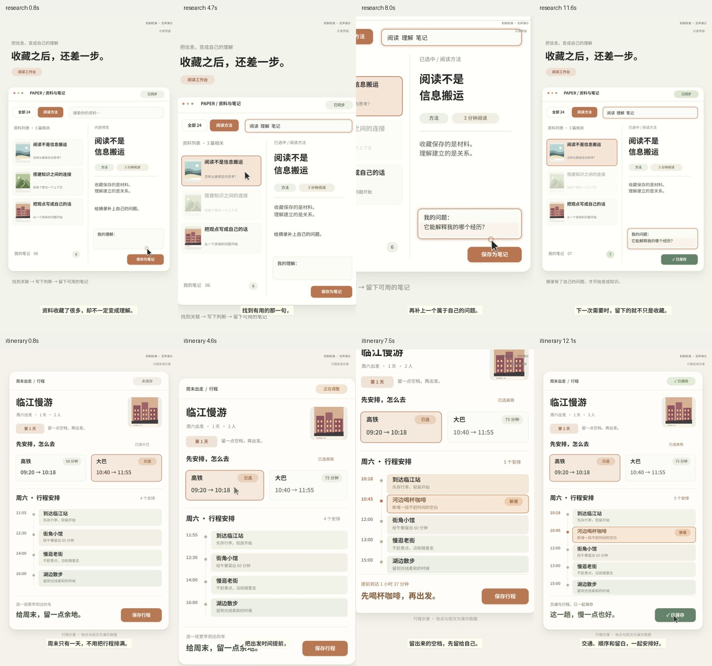

# portrait-editorial-explainer

把已有口播剪成具有同一类 **UI 设计与交互气质** 的竖屏讲解。信息层次、界面材质、操作反馈和镜头焦点有共同规则；每期的内容结构、布局、状态变化和剪法根据材料重新设计。

**v3.0.0-rc.2：UI 设计规则 + 可自由编排的界面舞台。** 新增10类 UI 元素、逐对象状态时间线和独立相机，不再只能在六套完整场景里替换文字和图片。原六组动作保留为可选示例。仍先交本期开头10–15秒，由用户判断观感后再做全片。

[下载候选安装包](https://github.com/3105059695-rgb/portrait-editorial-explainer/releases/download/v3.0.0-rc.2/portrait-editorial-explainer-v3.0.0-rc.2.zip) · [Skill入口](SKILL.md) · [UI设计规则](references/ui-style-system.md) · [自由编排契约](references/ui-composition-contract.md) · [制作流程](references/source-style-workflow.md) · [本次验证](docs/UI-COMPOSITION-RC2.md)

## 看两种不同的信息结构

以下是原创内容的无声界面演示，使用同一套 UI 部件，分别编排布局和操作。字幕用于说明机制，没有冒充真实配音。它们演示可组合能力，**当前尚未获得用户对新风格的认可**。

| 样例 | 界面和变化 |
|---|---|
| [资料工作台 · 15秒](docs/source-style/ui-research-opening.mp4) | 双栏资料界面：搜索、选中、摘录移入笔记、保存同步 |
| [周末行程 · 15秒](docs/source-style/ui-itinerary-opening.mp4) | 行程界面：按条件选择与调整时段，展示更新结果 |



它提供可执行的设计规则和稳定绘制能力，帮助模型少从零写动画。仍需要模型理解内容、挑选材料并看回放；没有证据保证任意低能力模型都自动达到参考观感。原片内部摄影、三维材质、音乐和剪辑判断也不会由几个组件自动恢复。

## 安装后直接调用

下载或克隆整个仓库，不要只拿SKILL.md。安装需要Python3.10+，渲染还需Node/npm、Remotion兼容浏览器、FFmpeg/ffprobe；依赖已锁版本。ChatCut只在未粗剪的真人口播分支需要，工具和账号由使用者环境提供。

```powershell
git clone https://github.com/3105059695-rgb/portrait-editorial-explainer.git
cd portrait-editorial-explainer
python -X utf8 scripts/install_skill.py --dry-run
python -X utf8 scripts/install_skill.py
python -X utf8 scripts/doctor.py --profile production
```

安装器默认写入 `$CODEX_HOME/skills`，未设置时写 `~/.codex/skills`；其他宿主使用 `--skills-dir <你的技能目录>`。它不覆盖非空同名目录。升级前先备份旧文件夹，或安装到新的技能父目录。无需作者电脑上的盘符、私人声音或账号。

重新打开Agent会话，输入：

```text
请使用 $portrait-editorial-explainer。
本期素材：<已有口播视频或最终配音的位置>。
素材类型：<真人原片 / 已粗剪 / 数字人 / 最终配音>。
使用这类 UI 视觉和交互语言，根据本期内容重新设计信息结构、布局和剪法。
优先组合已有 UI 部件与动作，表达不了时扩展，不要求照抄原片。
先制作实际开头10–15秒，我看过风格后再继续全片。
保留原人声，真人原片先用ChatCut粗剪，数字人跳过。
```

宿主不自动加载时，改成“请先读取 `<实际安装位置>/SKILL.md` 并执行”。只有文稿还没有声音时，可以先讨论分镜，但不能宣称已经完成最终音画同步，也不会自动生成配音或数字人。

## 无账号跑一个可编辑样段

在Skill根目录：

```powershell
python -X utf8 scripts/new_project.py --out ../my-opening
cd ../my-opening
npm ci
npm run check
npm run render
```

输出 `out/opening.mp4`，初始内容是明确标记的无声演示。`npm run dev`打开可编辑预览；`npm run still -- 2.4 7.8`导出静帧。首次渲染可能下载浏览器，也可设置运行时环境变量 `REMOTION_BROWSER_EXECUTABLE`，不把本机路径写进Skill。

换用另一个分镜，在Skill根目录：

```powershell
python -X utf8 scripts/source_episode.py validate examples/source-style/comic-calibration.json --media-dir examples/source-style/media
python -X utf8 scripts/source_episode.py build examples/source-style/comic-calibration.json --media-dir examples/source-style/media --out ../comic-opening
```

然后进入新工程执行同样的npm命令。没有外部媒体的分镜可省略media-dir。每次out使用新或空目录，已有工程不会被覆盖。

## 正式做本期

1. 确定素材类型并完成真实前序操作。原始真人先ChatCut粗剪并保存剪切映射；已粗剪沿用；数字人跳过粗剪；配音直接采用最终声音。
2. 提取字幕、实测关键词时点，把口播转换为“对象→动作→结果”。先确定界面结构、内容层级和状态变化，再组合 UI 元素、编排镜头；完整场景只在契合时选用。
3. 输出episode.json和所需素材，以相对路径组织media-root。真实截图/照片自行提供并记录来源；自绘界面标示意。
4. 正式校验与编译：

```powershell
python -X utf8 scripts/source_episode.py validate episode.json --production --media-dir media-root
python -X utf8 scripts/source_episode.py build episode.json --production --media-dir media-root --out ../this-episode
```

5. 在工程中 `npm ci`、`npm run check`、`npm run render`。默认只导出0秒开始的10–15秒，结束于完整话语边界。完整看听开头后交用户判断。
6. 用户明确认可后，把 `out/review.pending.json` 复制为 `review.json`，据实填写 `status:"approved"`、`reviewer:"user"`、`evidence` 中的真实反馈，保留当前JSON哈希。运行 `npm run render:full -- --approval review.json` 得到 `out/full.mp4`。

这个记录机制不能认证用户身份；使用Skill的Agent必须遵守“不能自己捏造用户认可”。改动JSON后旧记录会因哈希不符而失效。

## 复用范围

新 `ui-stage` 可在 JSON 中重新布置面板、导航、文本、图片、输入、按钮、图表、光标等，分别设置状态变化与镜头。它不规定布局、控件数量或操作顺序。六组旧场景保留原有边界。不能表达的动作允许新增：[扩展约定](references/source-style-extension.md)。新增后做局部校准，成熟效果再放回公共库。

新自由 UI 机制尚未单独做低能力模型盲测。历史六场景版本的试用真实使用gpt-6-luna low：JSON初次校验通过，人工指出“六条记录却显示84张比例票据”的问题后，增加精确事件数接口，模型自行改正；不能据此保证所有低能力模型都无需纠正。原始试用与后续渲染记录分别保存。

## 文件结构

```text
SKILL.md                         Agent入口
agents/openai.yaml               调用信息
references/ui-*.md               UI设计系统与自由编排契约
references/source-style-*.md     流程、通用契约、可选场景和扩展方法
scripts/source_episode.py        标准库校验器/编译器
scripts/install_skill.py         不覆盖旧目录的安装器
scripts/doctor.py                环境和资源检查
assets/source-style-template/    新默认Remotion组件与原创示意素材
examples/source-style/           可换题的数据示例及轻量模型试用
```

旧V2与早期职业/数学案例保留兼容；它们的运行命令和验证记录属于旧接口。`new_project.py --case adaptive` 才会明确进入旧V2，`presenter-v3`是历史案例名，并非当前数据契约v3。不要把历史文件里的“approved”理解为这次新参考已经通过用户认可。

## 来源与许可

本仓库独立编写的代码和原创SVG按MIT使用。第三方依赖、字体及历史图片许可见 [THIRD_PARTY_NOTICES](THIRD_PARTY_NOTICES.md)。未公开参考原片、其声音、肖像或提取画面。用户自行放入项目的素材应按各自权利使用；本Skill不自动授权收费服务、账号操作或发布。
