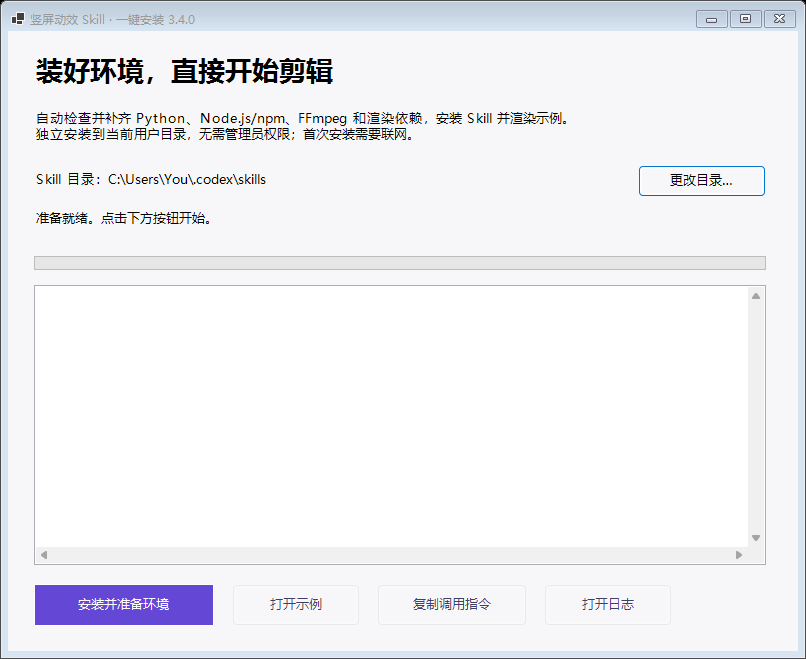

# 安装与首次使用

把一段指令发给这台电脑上的Codex，Agent负责下载、校验、安装、补齐依赖和示例试跑。使用者不需要手动下载解压或敲终端命令。当前自动安装支持Windows 10及以上的x64电脑；macOS／Linux保留手动安装方式，本次没有新增这两种系统的自动安装或实测结论。

返回 [README](../README.md) · [直接使用](../references/direct-use.md) · [故障排查](TROUBLESHOOTING.md)

## 复制给Codex的安装指令

```text
请阅读 https://raw.githubusercontent.com/3105059695-rgb/portrait-editorial-explainer/main/INSTALL_AGENT.md ，按说明在这台电脑安装 portrait-editorial-explainer，自动检查补齐依赖并试跑，完成后告诉我如何调用。
```

Codex需具备当前电脑的本地文件和命令执行能力。普通网页聊天如果不能访问本机，就不能替这台电脑完成安装。Agent按 [INSTALL_AGENT.md](../INSTALL_AGENT.md) 下载并核对发布包，运行底层安装器的headless入口，读取实际结果；不要把用户引导回手动下载、解压和命令列表。

首次需要联网，耗时取决于网络和磁盘。Agent会处理正常的环境准备，并报告实际失败阶段；只有示例渲染、探测和完整解码通过，才说明安装可用。完成后应给出Skill安装位置、样例视频位置和调用方式。它不会替使用者绕过系统或组织的必要确认。

## 自动安装会做什么

| 步骤 | 实际动作 |
|---|---|
| 检查工具 | 检查Python 3.10+、Node.js 22+及npm、FFmpeg与ffprobe，优先复用符合要求的工具 |
| 补齐环境 | 下载缺少的portable工具，按包内清单校验SHA256，然后放入当前用户的独立目录 |
| 安装Skill | 复制完整规则、脚本、模板和公开示例；升级已有本Skill时备份将被替换的文件，保留额外文件 |
| 准备工程 | 创建独立的公开quickstart工程，按锁文件执行npm ci，由Remotion准备渲染浏览器 |
| 验证可运行 | 执行工程检查，实际渲染12秒示例，检查视频尺寸、时长等信息并完整解码 |
| 完成 | 只有以上步骤成功且结果状态为ready，Agent才报告可用，并给出安装位置、示例和调用方法 |

安装过程不申请管理员权限，不修改全局PATH。依赖路径只传入当前安装或制作进程。它不会安装／登录Codex或ChatCut，也不会调用付费配音、数字人服务或上传视频。

示例是“整理旅行照片”的无声草案，包含公开图形和演示字幕；没有私人声音、人物视频或作者账号。示例能渲染证明当前制作环境可运行，不代表本期素材已完成剪辑。完整风格仍包含排版、真实素材、UI、空间镜头、图表和漫画，参考 [完整效果库](../references/full-effects-guide.md)。

## 文件放在哪里

| 内容 | 默认位置 |
|---|---|
| Skill | `$CODEX_HOME/skills/portrait-editorial-explainer`；未设置CODEX_HOME时为当前用户的 `~/.codex/skills/portrait-editorial-explainer` |
| 安装运行目录 | `%LOCALAPPDATA%\PortraitEditorialExplainer` |
| 本机工具配置 | 上述运行目录下的 `runtime.json` |
| 安装结果 | 上述运行目录下的 `setup-result.json`，成功状态为 `ready` |
| 日志 | 上述运行目录下的 `logs/install-时间-随机ID.log` |
| 升级备份 | 上述运行目录下的 `backups/` |

示例工程与视频的实际位置写在 `setup-result.json` 的 `projectRoot`、`sampleVideo` 中；Agent根据本次结果提供位置。自定义目录以实际安装结果为准。本机配置保存真实路径，不应复制到公开仓库或当作别人的运行配置。

## 在Agent中调用

安装完成后在Codex开新会话，必要时重新启动应用。发送：

```text
使用 $portrait-editorial-explainer。
这是本期数字人／口播视频／最终配音：<文件路径>，字幕：<若已有则提供>。
按完整参考的剪辑风格，根据本期内容重新选择素材、物件、镜头与转场。
请负责选效果、生成分镜和可编辑工程，先交本期10–15秒开头。
```

真人原始口播先ChatCut粗剪；已有粗剪直接沿用；数字人跳过这一步。Agent负责脚本与命令，普通使用者不必手写JSON。如果自动发现失败，把已安装 `SKILL.md` 的实际路径交给Agent，请它直接读取。

这台电脑上可以没有全局 `python` 或 `node` 命令。**Agent优先使用Skill根目录的 `Use-Skill.cmd`，不要在已成功安装后又要求使用者手装同一套工具。** 该入口调用本机runtime配置。以下命令仅供Agent或需要排查的人使用：

```powershell
& "<实际Skill目录>\Use-Skill.cmd" doctor.py -- --profile production
& "<实际Skill目录>\Use-Skill.cmd" effect_library.py -- describe reference-search --json
& "<实际Skill目录>\Use-Skill.cmd" start_episode.py -- --brief brief.json --srt captions.srt --media-dir media --voice final.wav --source-type narration --out ../this-episode
& "<实际Skill目录>\Use-Skill.cmd" run_project.py -- --project ../this-episode --action render
```

`Use-Skill.cmd`接收白名单中的脚本名，`--`后传该脚本参数。完整素材分流与示例见 [直接使用指南](../references/direct-use.md#自动安装后的运行入口)。

通常由Agent直接运行制作与渲染。需要自己打开工程时，也可以双击其中的备用入口：

- `Open-Preview.cmd`：启动Remotion预览，保留服务窗口；结束时关闭窗口或按Ctrl+C。
- `Render-Opening.cmd`：导出本期代表开头。
- `Render-Full.cmd`：导出完整视频。

这些入口在需要时按锁文件安装该工程的依赖，然后运行。素材路径、镜头和动作来自本期分镜；运行环境准备好不会自动替你完成素材选择和字幕对齐。

## 更新已有安装

**自动安装用户：** 再把上方安装指令发给Codex，并说明“更新已有安装”。Agent下载当前发布包并执行安装流程。安装器识别已有的同名Skill后，先备份本次会替换的文件，再写入新版；额外文件保留。备份放在运行目录的 `backups/`，不在Skill扫描目录内。无法识别的非空目录会被拒绝，不当作可覆盖目标。

本期视频工程和素材应独立存放，升级Skill不会改它们。若修改过Skill自带文件，可以从备份查看旧内容并按需要合并；不要把整份旧版本覆盖回新版。升级后开新会话，让Agent读到当前规则。

**旧手动安装用户：** `scripts/install_skill.py`仍是只复制Skill的轻量工具，拒绝覆盖非空目录，没有 `--force`。使用该脚本更新时，先保存并备份旧Skill到扫描目录之外，让正式目标不存在或为空，再执行安装；或者改用自动安装器处理受识别的旧版。

## 备用图形安装器

希望自己操作窗口时，可以下载 [v3.4.0完整ZIP](https://github.com/3105059695-rgb/portrait-editorial-explainer/releases/download/v3.4.0/portrait-editorial-explainer-v3.4.0.zip)，全部解压，在含 `SKILL.md` 的目录双击 `OneClick-Install.exe`，点击 **安装并准备环境**。完成后提供 **打开示例**、**复制调用指令**和 **打开日志**按钮。

源码ZIP或 `git clone`没有预编译exe时，可双击 `Install-Windows.cmd`，使用Windows.NET Framework编译器构建并打开安装器。若系统显示来源提示，核对仓库下载来源后正常确认；不需要禁用防护或修改PowerShell执行策略。

图形窗口和Agent自动安装复用相同的环境准备、备份与渲染验证流程。默认仍推荐把安装指令发给Codex，由Agent完成全部步骤。



## 手动安装与其他系统

这部分供macOS／Linux、其他Agent或已经管理好工具的使用者。Python脚本使用标准库；需要Python 3.10+、Node.js/npm、FFmpeg/ffprobe和Remotion兼容浏览器。建议Node.js 22+。Git仅用于clone，下载ZIP不需要Git。ChatCut只在真人原片粗剪分支需要另行连接。

下载完整仓库或解压ZIP后，在含 `SKILL.md` 的目录运行：

```shell
git clone https://github.com/3105059695-rgb/portrait-editorial-explainer.git
cd portrait-editorial-explainer
python scripts/install_skill.py --dry-run
python scripts/install_skill.py
python scripts/doctor.py --profile production
```

macOS／Linux将 `python` 换成 `python3`；Windows可用 `python -X utf8`，部分环境的命令是 `py -3`。`--dry-run`仅展示检查与复制计划，不安装依赖。`doctor.py --profile skill`只检查Skill资源和Python；默认production还检查Node/npm/FFmpeg/ffprobe，**doctor不会渲染视频**。

安装到其他宿主时，`--skills-dir`传技能父目录，例如：

```shell
python scripts/install_skill.py --skills-dir /path/to/agent/skills
```

安装器会追加 `portrait-editorial-explainer`，不要把名称在参数中再写一遍。工具只复制文件，不替其他Agent修改配置。宿主必须具备实际读取文件、执行命令的能力；本机安装不会自动出现在远程Agent中。

手动环境首次试跑：

```shell
python scripts/start_episode.py --brief examples/quickstart/brief.json --srt examples/quickstart/captions.srt --out ../my-first-opening --draft
cd ../my-first-opening
npm ci
npm run check
npm run render
```

输出 `out/opening.mp4`，静音与草案标记是预期状态。`npm run dev`打开预览，`npm run render:full`导出v3全片。输出目录必须不存在或为空，并放在Skill之外。入口不会覆盖旧工程。首次渲染需要联网准备浏览器；自带浏览器路径配置见 [故障排查](TROUBLESHOOTING.md#浏览器下载失败或找不到浏览器)。

## 本期素材与导出

已有SRT优先使用 [字幕与声音入口](../references/direct-use.md)。已有完整v3分镜或需要兼容v2自由图层时，用 `new_project.py --input episode.json --media-dir media-root --out ../this-episode`。媒体路径相对于本期素材根目录，不能写作者机器盘符；真人／数字人／配音按真实来源接入。

v3的 `npm run render` 导出 `out/opening.mp4`，`render:full`导出 `out/full.mp4`。v2原生render导出整个传入计划到 `out/adaptive-portrait.mp4`；通过一键入口导出v2开头时，再按现有字幕在10–15秒内的句末选择切点，另存 `out/opening.mp4`，没有合适句末会报错。v2计划仍应先写本期代表开头。历史 `--case presenter-v3`、`approved-reference` 只用于局部研究，不能作为新题默认模板。

正式输入需要定稿声音、实测字幕与相应粗剪状态；素材未就绪时明确使用 `--draft`，不伪造完成状态。用户给出材料和意图后由Agent完成这些配置。每期交付可播放视频、可编辑工程与素材来源，做必要成片检查即可。

## 卸载与保留工程

本包没有自动卸载或清理按钮。确需卸载时，先核对实际Skill和运行目录、备份个人改动与需要的示例工程，再处理这两个明确目录；不要删除整个 `.codex/skills` 或其他工具目录。独立视频工程、素材、Codex和ChatCut不随Skill卸载。
